# HustleHub+ — Docker Setup and Verification

## Member 4 — Containerisation and Deployment Preparation

**Project:** HustleHub+  
**Module:** INSY7314 / APDS7311 Part 3 POE  
**Repository:** https://github.com/EMGPSD/insy7314-g3-2026-poe-final-group-12

---

## 1. Purpose

Docker was implemented to provide a consistent local environment for running the HustleHub+ frontend, backend and MongoDB database.

Docker Compose coordinates the three services and provides networking, environment configuration, health checks and persistent database storage.

The implementation was tested using Docker Desktop on Windows.

This setup demonstrates local container deployment readiness. It does not, by itself, constitute a public production deployment.

---

## 2. System Architecture

The application uses three Docker Compose services:

| Service | Technology | Purpose |
|---|---|---|
| Frontend | React/Vite and Nginx | Serves the web application |
| Backend | Node.js and Express | Provides application APIs |
| Database | MongoDB 8 | Stores application data |

### Architecture

```text
Browser
   |
   | http://localhost:3000
   v
Frontend Container
Nginx (Port 8080)
   |
   | Reverse proxy
   v
Backend Container
Node.js / Express (Port 5000)
   |
   | Internal Docker network
   v
MongoDB Container
Port 27017
   |
   v
Persistent Docker Volume
mongodb_data
```

Only the frontend is exposed to the host through `127.0.0.1:3000`.

The backend and database communicate over the internal Docker Compose network.

### Figure 1 — Docker Compose Services


- Docker Desktop Containers page
- HustleHub+ Compose project expanded
- Frontend, backend and MongoDB containers
- Running status for all services

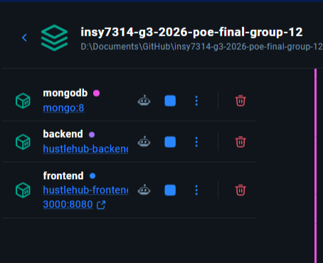

---

## 3. Prerequisites

Install:

- Docker Desktop
- Git
- A code editor such as Visual Studio Code

Docker Desktop must be running before starting the application.

The Docker Compose CLI must also be available.

Verify installation:

```powershell
docker --version
docker compose version
```

---

## 4. Repository Structure

The relevant Docker files are:

```text
insy7314-g3-2026-poe-final-group-12/
|
|-- compose.yaml
|-- .env.docker.example
|-- .env.docker
|-- .gitignore
|
|-- hustlehub-backend/
|   |-- Dockerfile
|   |-- .dockerignore
|   |-- package.json
|   |-- package-lock.json
|   `-- src/
|
|-- Frontend/
|   |-- Dockerfile
|   |-- .dockerignore
|   |-- nginx.conf
|   |-- package.json
|   `-- package-lock.json
|
```

The `.env.docker` file contains local environment configuration and must not be committed to GitHub.

---

## 5. Environment Configuration

From the repository root, create a local environment file using `.env.docker.example` as the template.

Example:

```powershell
Copy-Item .env.docker.example .env.docker
```

Generate a random JWT secret using PowerShell:

```powershell
$bytes = New-Object byte[] 48
[System.Security.Cryptography.RandomNumberGenerator]::Fill($bytes)
[Convert]::ToBase64String($bytes)
```

Place the generated value into `.env.docker`:

```dotenv
JWT_SECRET=replace-with-your-generated-secret
```

Do not publish the actual secret or include it in screenshots.

The Compose configuration supplies the other backend environment values.

---

## 6. Starting the Application

Open PowerShell in the repository root.

Validate the Compose configuration:

```powershell
docker compose --env-file .env.docker config --quiet
```

Build and start the services:

```powershell
docker compose --env-file .env.docker up -d --build
```

Check their status:

```powershell
docker compose --env-file .env.docker ps
```

Expected result:

- MongoDB: healthy
- Backend: healthy
- Frontend: healthy

The frontend may temporarily display `health: starting` while its health check runs.

### Figure 2 — Successful Docker Build


- PowerShell showing `docker compose up -d --build`
- Frontend and backend images built
- Containers started successfully

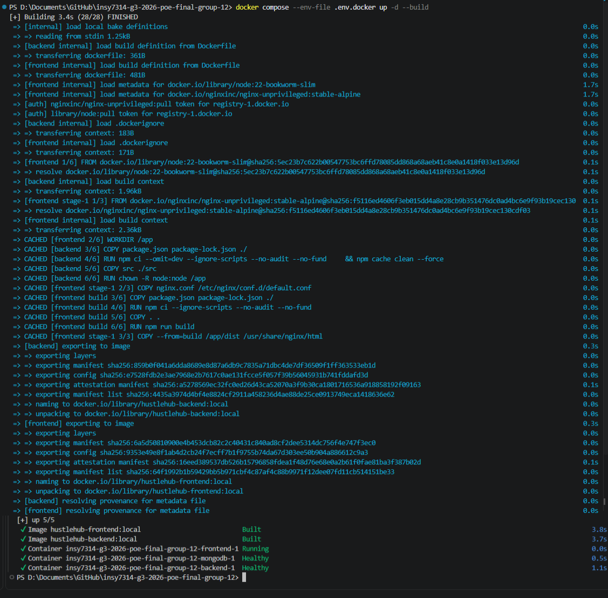

### Figure 3 — Healthy Containers


- PowerShell `docker compose ps`
- All three containers showing healthy status
- Frontend port mapping

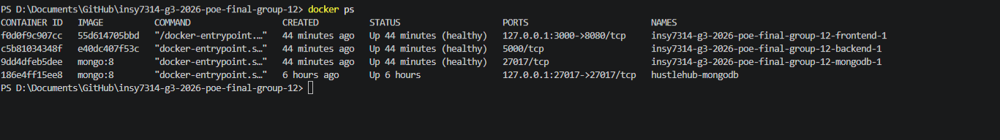

---

## 7. Frontend Container

The frontend uses a multi-stage Docker build.

The first stage installs dependencies and builds the Vite application.

The second stage serves the compiled application using Nginx.

The runtime image is:

`nginxinc/nginx-unprivileged:stable-alpine`

Nginx runs as a non-root user and listens on port `8080`.

Docker Compose maps host port `3000` to container port `8080`.

### Figure 4 — Frontend Dockerfile


- `Frontend/Dockerfile`
- Multi-stage build
- `npm ci --ignore-scripts`
- Unprivileged Nginx image
- `EXPOSE 8080`

### Figure 5 — Frontend in Browser


- Browser address `http://localhost:3000/gigs`
- HustleHub+ navigation
- Explore gigs page rendered successfully

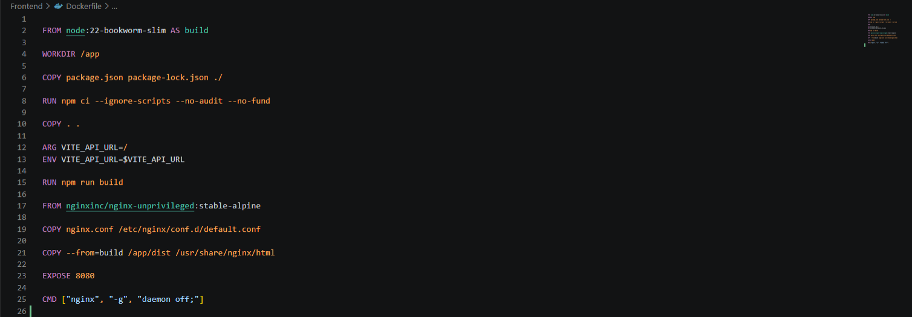

---

## 8. Backend Container

The backend uses the Node.js 22 slim image.

Production dependencies are installed using:

```dockerfile
RUN npm ci --omit=dev --ignore-scripts --no-audit --no-fund \
    && npm cache clean --force
```

The application runs under the non-root `node` user.

The backend listens on port `5000` within the Docker network.

### Figure 6 — Backend Dockerfile


- `hustlehub-backend/Dockerfile`
- Production dependency installation
- Non-root `USER node`
- Exposed port 5000

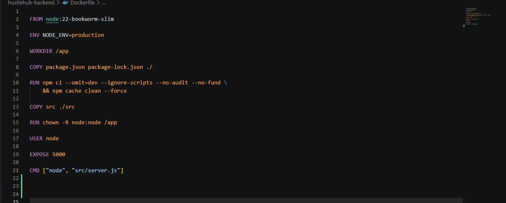

---

## 9. Nginx Reverse Proxy

Nginx serves the frontend and forwards selected requests to the backend service.

Configured proxy routes include:

- `/api/`
- `/health/`
- Authentication routes such as `/login`, `/register` and `/logout`

The proxy uses Docker's internal service hostname:

`backend:5000`

This allows the frontend and backend to communicate without exposing the backend directly to the host.

### Figure 7 — Nginx Configuration


- `Frontend/nginx.conf`
- Port 8080
- `/api/` proxy configuration
- `/health/` proxy configuration
- SPA fallback route

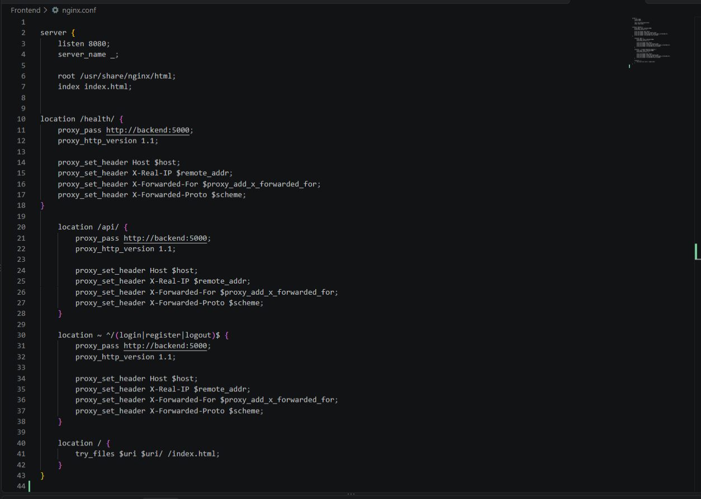

---

## 10. Docker Health Checks

Docker Compose includes health checks for all three services.

### MongoDB

Uses `mongosh` to verify that the database responds to a ping.

### Backend

Calls:

`http://127.0.0.1:5000/health/ready`

The endpoint returns HTTP 200 when MongoDB is connected and HTTP 503 when it is unavailable.

### Frontend

Uses `wget` to check the Nginx HTTP server on port `8080`.

Startup dependencies are configured so that:

1. MongoDB becomes healthy.
2. Backend starts and becomes healthy.
3. Frontend starts.

### Figure 8 — Health Check Configuration


- `compose.yaml`
- Health checks for MongoDB, backend and frontend
- `depends_on` conditions

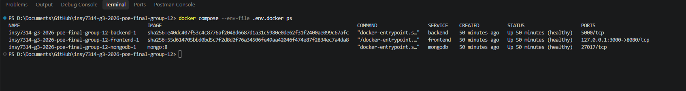

### Figure 9 — Health Endpoint Responses


- PowerShell commands calling `/health/live` and `/health/ready`
- `ok` liveness response
- `ready` and `connected` readiness response

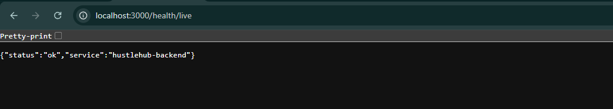

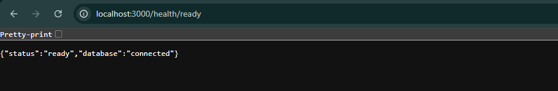

---

## 11. Non-Root Container Security

Both the frontend runtime and backend are configured to run without root privileges.

To verify the frontend runtime user:

```powershell
docker compose --env-file .env.docker exec frontend id
```

Recorded result:

```text
uid=101(nginx) gid=101(nginx) groups=101(nginx)
```

### Figure 10 — Non-Root Verification


- PowerShell showing the `exec frontend id` command
- UID 101 result

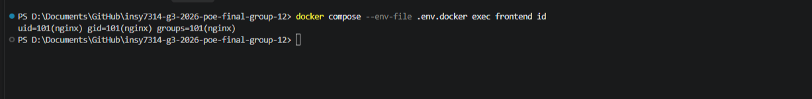

---

## 12. MongoDB Persistent Storage

MongoDB uses a named Docker volume:

`mongodb_data`

The volume stores database files independently of the MongoDB container lifecycle.

A persistence test was performed by inserting a temporary record, restarting MongoDB and retrieving the same record.

The original ObjectId was preserved.

The temporary test collection was removed afterward.

### Figure 11 — MongoDB Persistence Test


- Successful insertion of a test record
- MongoDB restart
- Successful retrieval of the same record
- Matching ObjectId


```Text
Step 1 — Insert a test record

    docker compose --env-file .env.docker exec mongodb mongosh hustlehub --quiet --eval 'db.docker_persistence_test.insertOne({ test: "member4-persistence", createdAt: new Date() })'

Step 2 — Restart MongoDB

    docker compose --env-file .env.docker restart mongodb

Wait awhile until MongoDB becomes healthy:

    docker compose --env-file .env.docker ps

Step 3 — Verify the record survived

    docker compose --env-file .env.docker exec mongodb mongosh hustlehub --quiet --eval 'db.docker_persistence_test.find({ test: "member4-persistence" }).toArray()'
```
---

## 13. Container Recreation Test

The entire Docker environment was stopped and recreated using:

```powershell
docker compose --env-file .env.docker down
docker compose --env-file .env.docker up -d
```

The services restarted successfully.

After recreation:

- MongoDB became healthy.
- Backend became healthy.
- Frontend became healthy.
- Health endpoints responded.
- The gigs API responded.
- The browser rendered the Explore gigs page.

The MongoDB restart test separately verified record persistence. The recreation test verified service recovery, but did not independently recheck a retained record after recreation.

#### Container Recreation

- PowerShell showing `docker compose down`
- Containers removed
- `docker compose up -d`
- Containers recreated successfully


---

## 14. API Verification

Run:

```powershell
Invoke-RestMethod http://localhost:3000/health/live
Invoke-RestMethod http://localhost:3000/health/ready
Invoke-RestMethod http://localhost:3000/api/gigs
```

Expected behavior:

- Liveness returns an OK status.
- Readiness returns ready when MongoDB is connected.
- Gigs returns a valid API response.

An empty gigs list is expected when no gigs have been created in the local database.

---

## 15. Docker Desktop Evidence

Docker Desktop can be used to capture additional evidence.

Recommended screenshots include:

- Container list showing running services
- Frontend Inspect tab showing healthy status
- Backend Inspect tab showing healthy status
- MongoDB Inspect tab showing healthy status
- Frontend port mapping
- MongoDB named volume
- Container logs without sensitive information

### Figure 14 — Frontend Inspection


- Docker Desktop frontend container Inspect tab
- `Health.Status` equal to `healthy`
- Health check exit code 0

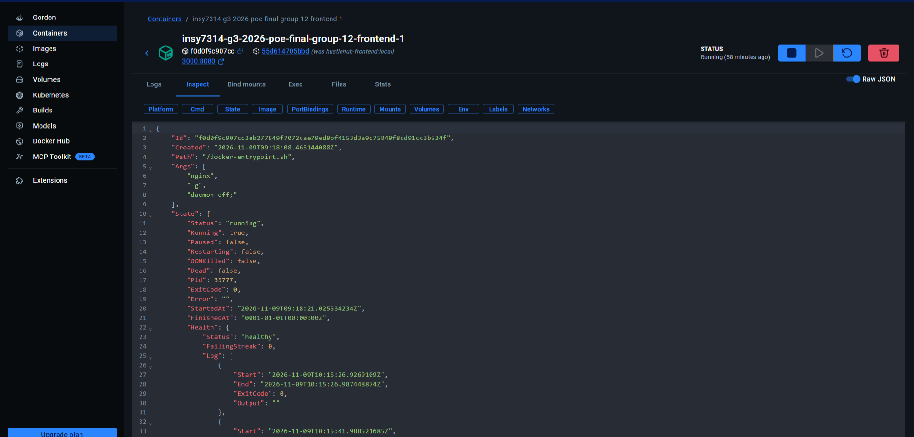


### Figure 15 — Backend Inspection


- Docker Desktop backend container Inspect tab
- `Health.Status` equal to `healthy`

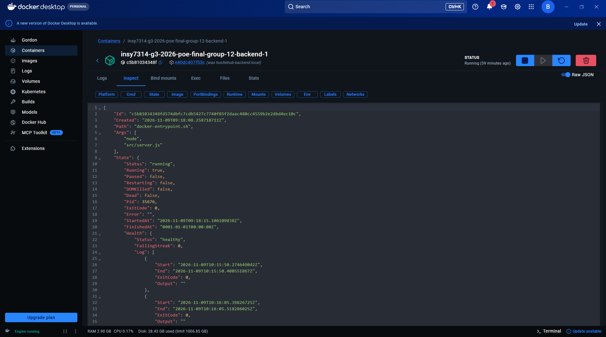

---

## 16. Stopping the Application

Stop the services while retaining their containers:

```powershell
docker compose --env-file .env.docker stop
```

Start them again:

```powershell
docker compose --env-file .env.docker start
```

Remove containers and the Compose network while preserving named volumes:

```powershell
docker compose --env-file .env.docker down
```

Do not use `down -v` unless intentionally deleting the local database volume and its data.

---

## 17. Troubleshooting

### Frontend shows `health: starting`

Wait for the configured health check to complete and run `docker compose ps` again.

### Frontend cannot reach backend

Check that Nginx is proxying API requests to `backend:5000`.

### Backend is unhealthy

Check MongoDB status and backend logs:

```powershell
docker compose --env-file .env.docker logs --tail 100 backend
```

### MongoDB is unhealthy

Inspect its logs:

```powershell
docker compose --env-file .env.docker logs --tail 100 mongodb
```

### Frontend returns HTML for health requests

Verify that `nginx.conf` includes a `/health/` proxy location.

### Port 3000 is unavailable

Stop the conflicting local application or change the host-side port mapping in `compose.yaml`.

---

## 18. SonarQube Security Verification

Docker-related security findings were corrected by:

- Running Nginx as a non-root user.
- Disabling npm installation scripts during frontend image construction.
- Disabling npm installation scripts during backend image construction.

Fresh Docker builds and runtime checks passed.

The recorded SonarQube analysis subsequently reported a passing Quality Gate and zero issues.

See `SONARQUBE_GUIDE.md` for detailed evidence and team instructions.

---

## 19. Final Verification Checklist

- [x] Backend Dockerfile created and tested.
- [x] Frontend Dockerfile created and tested.
- [x] Nginx reverse proxy configured.
- [x] Docker Compose orchestration implemented.
- [x] MongoDB health check passed.
- [x] Backend health check passed.
- [x] Frontend health check passed.
- [x] Non-root Nginx execution verified.
- [x] Frontend and backend security build changes tested.
- [x] MongoDB restart persistence verified.
- [x] Full container recreation verified.
- [x] Browser frontend verified.
- [x] Health endpoints verified.
- [x] Gigs API response verified.
- [x] SonarQube Quality Gate passed in recorded analysis.


---

## 20. Member 4 note

Docker and Docker Compose provide a reproducible local runtime for HustleHub+.

The frontend, backend and MongoDB services were successfully containerised, connected and tested.

Health checks, startup dependencies, non-root execution and persistent database storage improve reliability and security.

The environment successfully recovered after container recreation and remained accessible through the browser and API endpoints.

These results demonstrate local container deployment readiness for the Part 3 POE.
